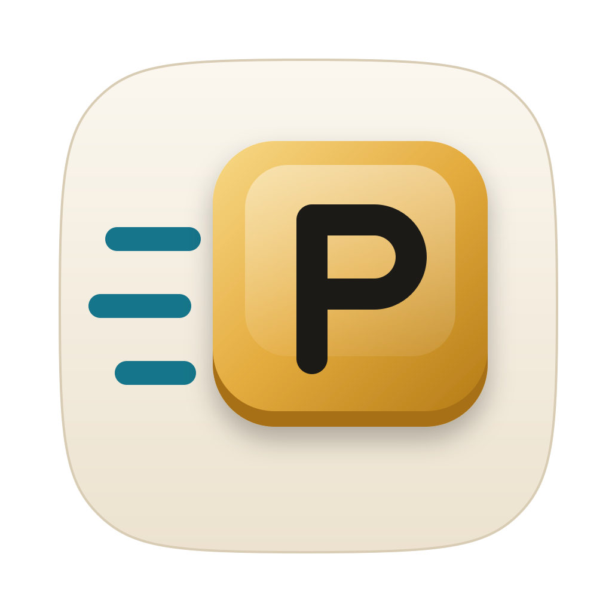
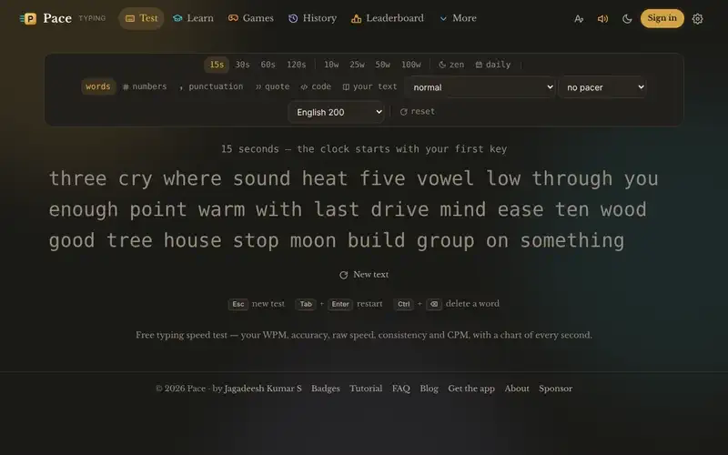
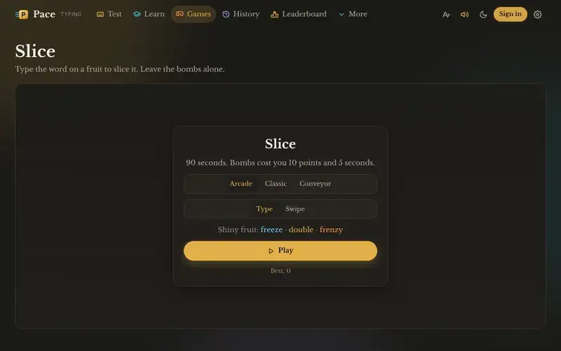
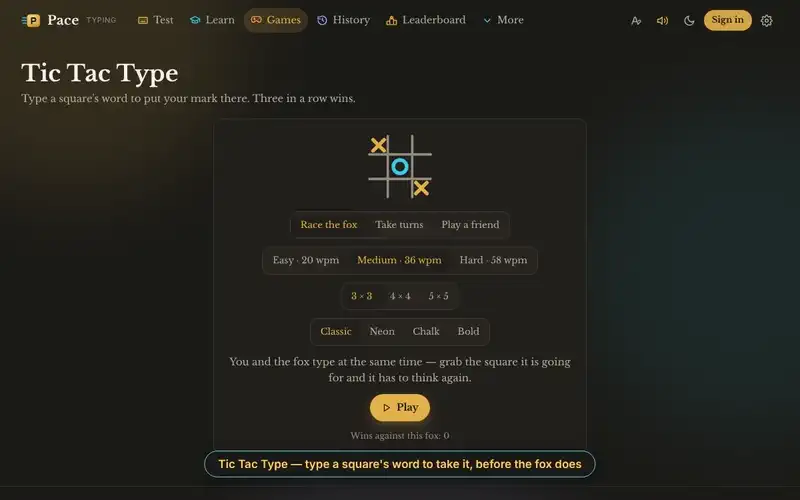
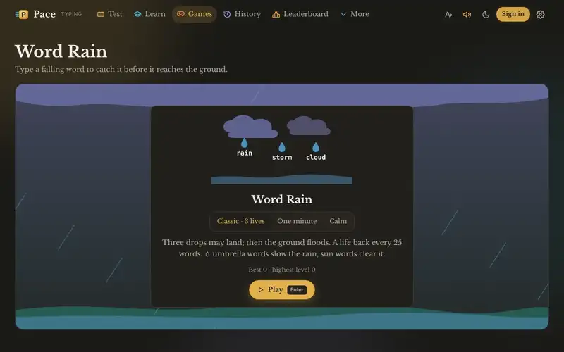
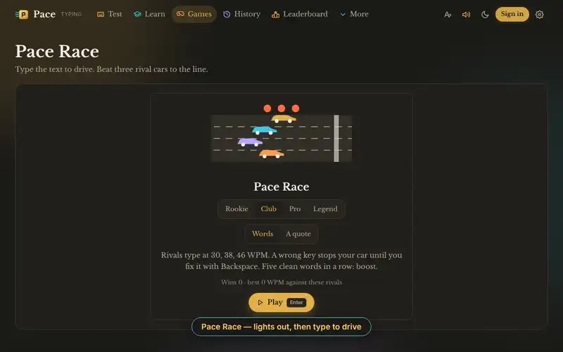
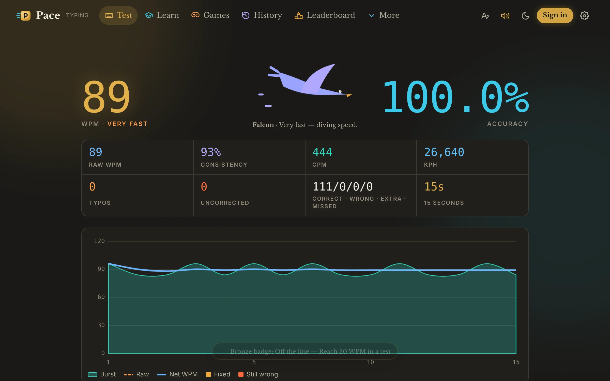
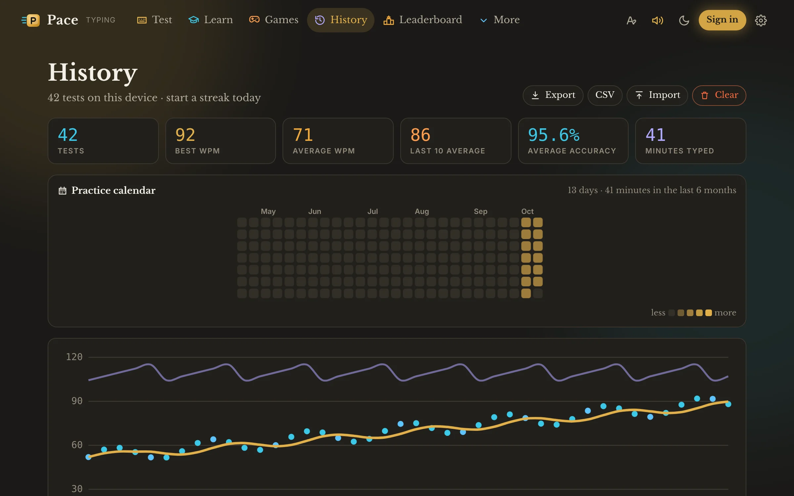

  <picture>
    <source media="(prefers-color-scheme: dark)" srcset="assets/icon-dark.svg">
    
  </picture>

<h1 align="center">Pace</h1>

<b>Type faster. Play sharper.</b> 
A free typing speed test with touch-typing lessons and typing games — a Mac app for Apple silicon,
an iPhone and iPad app, and a website.

⭐ <b>If Pace helps you type faster, please star this repository</b> — it helps other people find it. ⭐

  <a href="https://ipconfig.co.network/typing-test/"><b>Try it in your browser</b></a> ·
  <a href="https://github.com/JKS-sys/pace-17-Oct-2026-releases/releases/latest"><b>Downloads</b></a> ·
  <a href="#install">Install with Pour</a>

▶ <a href="docs/demos/test.mp4">Watch with sound</a>

## What you get

- **A typing test** — 15 to 120 seconds or 10 to 100 words; words, numbers, punctuation, quotes,
  code or your own text, in ten word lists. WPM, raw WPM, accuracy, consistency, CPM, KPH, typos,
  a chart of every second and your weak keys and fingers.
- **Your progress** — every test on your device in about 40 bytes, a progress chart, eight
  layouts, a day streak, export and import. Nothing leaves your device unless you post a score.
- **Lessons** — eleven touch-typing lessons with stars, a drill from your own weak keys and an AI
  coach that writes practice text about anything.
- **Modes** — zen, a daily challenge, Expert and Master, a pacer or your own ghost to race;
  44 badges, a practice calendar and a speed mascot on every result.
- **Games** — *Slice* (cut the fruit by typing its word), *Tic Tac Type* (race a fox for every
  square), *Word Rain* (catch falling words), *Pace Race* (out-type three rival cars) and
  *Bubble Pop* (pop the bubbles before they float away).
- **A plan and a coach** — a four-week practice plan, ladders that race the clock, a progress
  report with weekly trends and weak-key coaching, daily goals and a streak calendar.
- **Trainers and tools** — numpad, symbols and keyboard-layout trainers, a library for your own
  texts, a command palette (⌘K or Ctrl-K), a shortcuts sheet (?), break reminders and
  accessibility options. With Pace Pro: a theme editor and a sound designer.
- **Any text becomes a test** — open a text file with Pace on a Mac, iPhone or iPad, or use
  Services → Type this in Pace on a Mac.
- **Small and quick** — the Mac app is about 2.3 MB, the website loads the typing test first and
  everything else when it is needed, and works offline once visited.

  
  
  
  

  
  

## Store, coins and hearts

- **Pace Pro** for a week (₹9), monthly (₹20) or yearly (₹220) that renew until you cancel, one year (₹220) or for life (₹999).
- **Hearts** continue Word Rain and Bubble Pop after the last life — three free every day, packs of 10 to 500.
- **Pace Coins** unlock ninety extras: colour themes, typing fonts, caret shapes, frames, sound packs, results cards, skins for all seven games, mascots and boosters. Buy them, or earn up to 150 a day by practising.
- **Pace Pass** — a monthly season of extras plus 300 coins and 30 hearts; **bundles**, two-year, family and gift Pro on the website.
- **On the App Store** everything is bought with Apple's in-app purchase, with Restore purchases.
- **One account** for every app on ipconfig.co.network: plans, orders, gift codes, computers, sessions, profile, security, activity and help, inside Pace.

## Install

| System | |
|---|---|
| **Mac (Apple silicon)** | `curl -fsSL https://ipconfig.co.network/pour/install \| sh` then `pour install --cask pace` |
| **iPhone, iPad** | the App Store, or open the website in Safari → Share → Add to Home Screen |
| **No install** | [ipconfig.co.network/typing-test](https://ipconfig.co.network/typing-test/) |

Pace is a Mac app for Apple silicon (M-series, macOS 12 or newer): Pour installs it and it
updates itself. A build without Apple's Developer ID is signed with the creator's own permanent
certificate: if macOS says it is damaged on first launch, run `xattr -cr /Applications/Pace.app` once.

## Licence

Pace is free to use and proprietary — © 2026 Jagadeesh Kumar S, all rights reserved; see
[LICENSE](LICENSE). Licence texts that ship with it:
[THIRD-PARTY-NOTICES.txt](THIRD-PARTY-NOTICES.txt). This repository holds the downloads and the
update feed; the source is private.

⭐ <b>Star this repository</b> if Pace is useful to you — thank you! ⭐

Made by <a href="https://ipconfig.co.network/pace">Jagadeesh Kumar S</a> · <a href="https://razorpay.me/@NSBJKS">Sponsor the creator</a>

